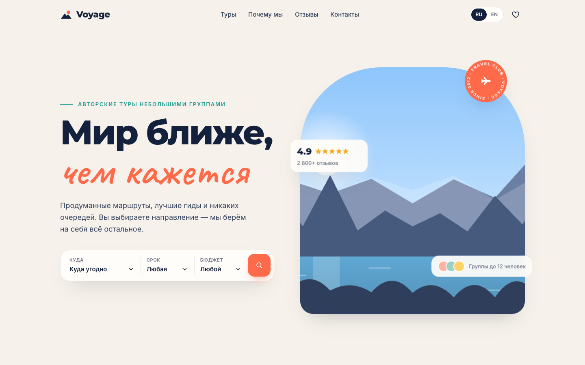
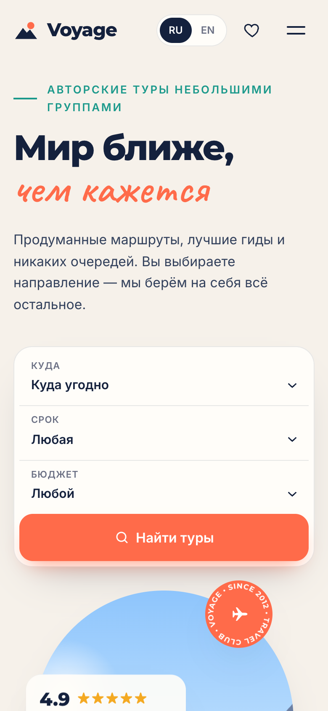

<div align="center">

# Voyage

**Сайт турагентства на React** · RU / EN

<a href="https://cdduke.github.io/voyage-travel/"></a>

    

&nbsp;

*🇬🇧 Travel agency SPA — procedural SVG landscapes, catalogue filters with animated layout, favourites and a validated booking flow.*

</div>

---

Концепт сайта авторских туров: каталог с фильтрами, избранное, карточка тура и бронирование.
Все «фотографии» — это **пейзажи, которые генерирует код** (SVG): горы, море, пустыня, мегаполис,
северное сияние, острова, лес, саванна. **Двуязычный: русский (по умолчанию) и английский.**

**Стек:** React 19 · TypeScript (strict) · Vite · Motion (Framer Motion) · CSS без фреймворков

## Что внутри

- **Генератор пейзажей `<Scene>`**: детерминированный PRNG (mulberry32) + палитра → уникальная иллюстрация
  для каждого направления; слои с `data-depth` дают параллакс за курсором в hero
- **Каталог**: фильтр по континентам, слайдер бюджета, длительность, сортировка, «только избранное»,
  счётчик результатов, пустое состояние; карточки анимируются при фильтрации (`layout` + `AnimatePresence`)
- **Поиск в hero** выставляет фильтры и плавно прокручивает к каталогу
- **Избранное** с сохранением в `localStorage` (свой хук `useLocalStorage`), счётчик в шапке, toast-уведомления
- **Модальное окно тура**: главное, маршрут по дням, форма бронирования с валидацией, расчёт суммы,
  экран успеха; ловушка фокуса, закрытие по Esc, блокировка скролла; на телефоне — bottom sheet
- Анимированные счётчики, появление секций при скролле, подписка на рассылку с валидацией
- **i18n на React Context**: типизированные ключи, `Intl` для валют и чисел, язык сохраняется

## Адаптивность и доступность

- Проверено на 390px, 820px и 1440px (скриншоты и сценарий бронирования прогнаны через headless Chrome)
- `MotionConfig reducedMotion="user"` + CSS `prefers-reduced-motion`
- Семантика, `aria-pressed` у переключателей, `aria-invalid`/`role="alert"` в форме, видимый фокус

## Запуск

```bash
npm install
npm run dev      # http://localhost:5176
npm run build    # tsc + сборка
```

---

*Concept website built as a portfolio piece — no bookings are sent. Bilingual: Russian / English.*


**Демо:** https://cdduke.github.io/voyage-travel/
